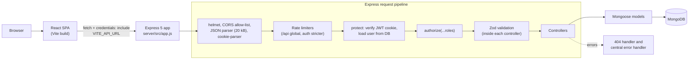
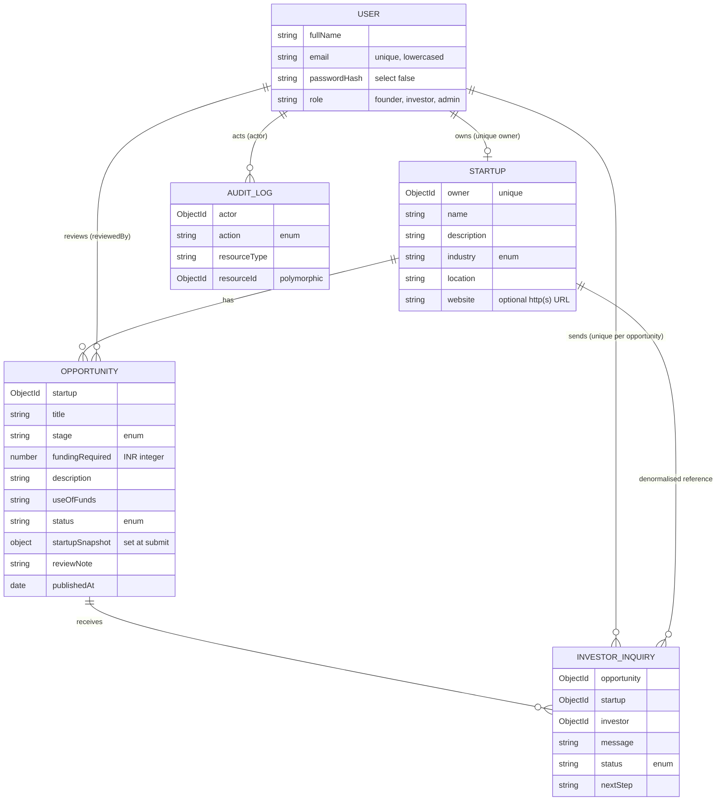
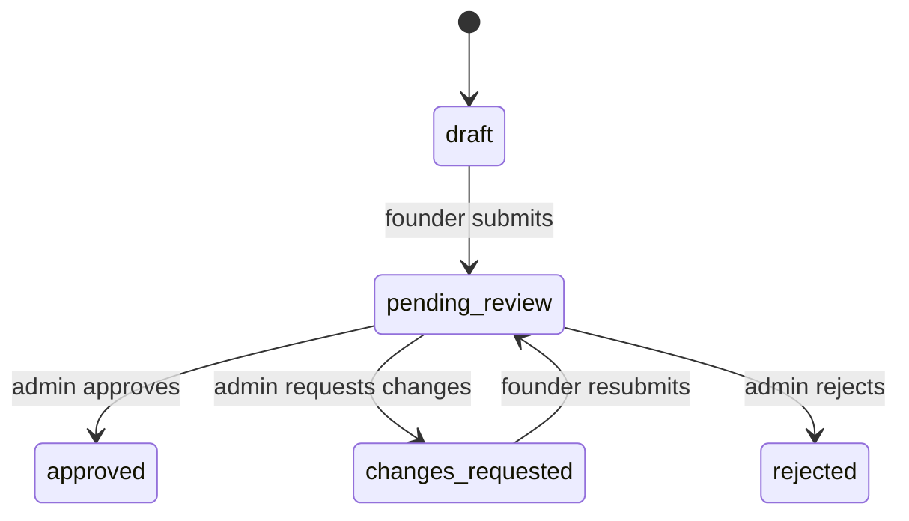
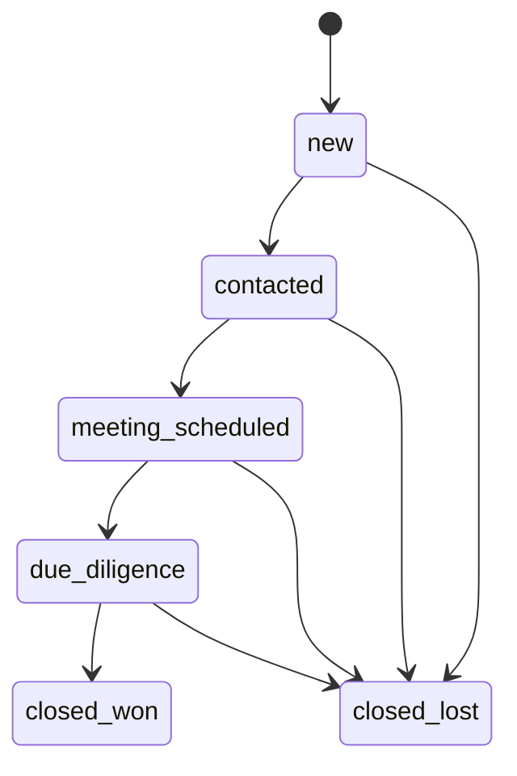
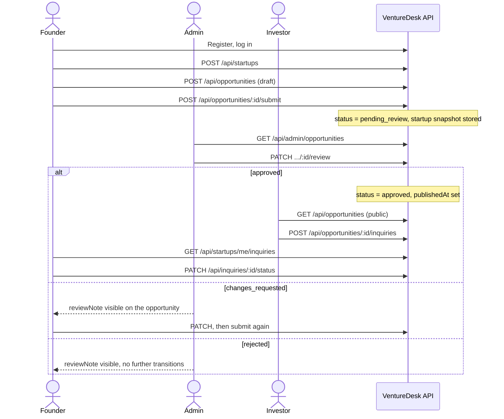

<div align="center">

# VentureDesk

**A role-based workflow for taking a startup from draft, to reviewed, to investor-ready.**


</div>

VentureDesk is a MERN-stack application that connects three groups around one controlled workflow. **Founders** describe their startup and package a funding request as an *opportunity*. **Admins** review each submitted opportunity and approve it, reject it, or send it back with feedback. **Investors** browse only the approved opportunities and open an inquiry, which the founder then moves through a simple deal pipeline.

| | |
| --- | --- |
| **Stack** | MongoDB, Express.js, React (TypeScript + Vite), Node.js |
| **Auth** | JWT in an `HttpOnly` cookie, bcrypt password hashing, role-based access control (founder, investor, admin) |
| **AI tool used** | **Kiro** (primary), plus Antigravity with Claude for final refinement and ChatGPT for planning and debugging. See [AI-Assisted Development Experience](#ai-assisted-development-experience). |

## Table of Contents

1. [Project Description](#project-description)
2. [Features](#features)
3. [Technologies Used](#technologies-used)
4. [Setup and Installation](#setup-and-installation)
5. [How to Run the Application](#how-to-run-the-application)
6. [AI Tool Used: Kiro](#ai-tool-used-kiro)
7. [AI-Assisted Development Experience](#ai-assisted-development-experience)
8. [Architecture and Request Flow](#architecture-and-request-flow)
9. [User Roles and Permissions](#user-roles-and-permissions)
10. [Project Structure](#project-structure)
11. [Environment Variables](#environment-variables)
12. [API Reference](#api-reference)
13. [Database Models and Relationships](#database-models-and-relationships)
14. [Authentication and Security](#authentication-and-security)
15. [Application Workflows](#application-workflows)
16. [Testing and Quality Assurance](#testing-and-quality-assurance)
17. [Build and Deployment](#build-and-deployment)
18. [Troubleshooting](#troubleshooting)
19. [Engineering Decisions](#engineering-decisions)
20. [Known Limitations and Future Improvements](#known-limitations-and-future-improvements)
21. [License and Author](#license-and-author)

---

## Project Description

Early-stage fundraising has two recurring problems: investors see listings of uneven quality, and founders get little structured feedback. VentureDesk addresses both by putting a review step between a founder's draft and the investor-facing catalogue.

| Role | What they do in VentureDesk |
| --- | --- |
| **Founder** | Creates one startup profile, drafts funding opportunities, submits them for review, revises them if changes are requested, and manages incoming investor inquiries. |
| **Admin** | Works a review queue of submitted opportunities and records a decision, with a mandatory note when requesting changes or rejecting. |
| **Investor** | Searches and filters approved opportunities (no account needed to browse), sends one inquiry per opportunity, and tracks or withdraws their own inquiries. |

Two design choices shape the data model. First, when a founder submits an opportunity the server stores a **snapshot** of the startup's details with it, so investors see exactly what the admin reviewed, even if the founder later edits their profile. Second, ownership and identity are always derived on the server from the authenticated session and the database, never from fields the client sends.

---

## Features

Everything below is implemented in the source code. Items marked **Partial** or **Not implemented** are called out explicitly.

**Authentication and accounts**
- Registration (founder or investor), login, logout, and session restore on page load.
- JWT in an `HttpOnly` cookie; bcrypt password hashing (cost 12); role-based route guards in the SPA and role checks on every protected API route.
- **Partial:** the profile page shows account details and a logout action only. There is no profile editing, password change, or password reset.
- **Not implemented:** admin sign-up. Admins are created with the demo seed script or directly in the database.

**Founder workspace**
- Dashboard with opportunity and inquiry counts computed from live API data.
- One startup profile per founder (create, view, edit) with a fixed industry list.
- Opportunity drafts (create, edit, list) with a completeness check before submission.

**Admin review**
- Review queue (default filter `pending_review`) with a detail view.
- Three decisions: approve, request changes, reject. A review note is required for the last two.
- Atomic status transitions that guard against concurrent reviews.
- Append-only audit records for submissions, reviews, and inquiry events (stored only; not exposed through an endpoint).

**Opportunity discovery**
- Public catalogue of approved opportunities with search, industry, stage, location, and funding-range filters, sorting, and pagination.
- Public responses are built from the reviewed snapshot only, never from owner IDs, review notes, or reviewer fields.
- Funding amounts are whole numbers in INR, displayed in lakh/crore notation.

**Investor inquiries**
- Investors send a message (max 1000 characters) on an approved opportunity; a unique index prevents duplicates.
- Founders see inquiries for their own startup (investor display name only, never email) and move them through `new → contacted → meeting_scheduled → due_diligence → closed_won | closed_lost`.
- Investors can withdraw their own inquiry (`closed_lost`).
- **Partial:** the API accepts an optional `nextStep` note and the founder view displays it, but the UI has no input for it.

**User interface**
- React single-page app with CSS Modules and shared design tokens, a role-aware sidebar shell, toast notifications, skeleton loaders, and empty and error states with retry. `client/design.md` documents the visual system.

**Security and validation**
- Zod schemas on every request body and query string, in strict mode so unknown fields are rejected.
- `helmet`, an exact-match CORS allow-list, a 20 kB JSON body limit, and rate limiting.

---

## Technologies Used

**Frontend (`client/`)**

| Technology | Role |
| --- | --- |
| React `^19` + TypeScript `~6` | UI and typed API contracts |
| Vite `^8` | Dev server and production bundler |
| React Router `^7` | Client-side routing and role-based guards |
| CSS Modules + CSS custom properties | Styling and design tokens (Tailwind is not used) |
| `lucide-react` | Icons |
| Oxlint | Linting |

**Backend (`server/`)**

| Technology | Role |
| --- | --- |
| Node.js (CommonJS) + Express `^5` | REST API |
| MongoDB + Mongoose `^9` | Database, schemas, validation, and queries |
| Zod `^4` | Request body and query validation |
| `jsonwebtoken`, `bcryptjs`, `cookie-parser` | Authentication |
| `helmet`, `cors`, `express-rate-limit` | Security middleware |
| `dotenv`, `nodemon` (dev) | Configuration and auto-restart |

**Tooling:** Kiro (AI-assisted development). The repository has no CI, Docker, or test framework; see [Testing](#testing-and-quality-assurance).

---

## Setup and Installation

### Prerequisites

| Requirement | Detail |
| --- | --- |
| **Node.js** | `^20.19.0` or `>=22.12.0`. The project declares no `engines` field; this range is what the installed Vite 8 and Mongoose 9 require. Verified on Node 22.22.0. |
| **npm** | Lockfiles are `package-lock.json`. Verified with npm 10.9.4. |
| **MongoDB** | A MongoDB Atlas cluster or a local MongoDB server, reachable through a connection string. |
| **Git** | To clone the repository. |

### Install

There is no root-level `package.json`. `client/` and `server/` are installed separately.

```bash
git clone https://github.com/<your-username>/VentureDesk.git
cd VentureDesk

# Backend
cd server
npm install
cp .env.example .env          # Windows PowerShell: Copy-Item .env.example .env

# Frontend (from the repository root)
cd ../client
npm install
```

### Configure the backend

Edit `server/.env`:

- Set `MONGODB_URI` to your Atlas or local connection string (the example file holds a placeholder).
- Set `JWT_SECRET` to a long random value. The server warns if it is shorter than 32 characters. To generate one:

  ```bash
  node -e "console.log(require('crypto').randomBytes(48).toString('hex'))"
  ```

- Leave `CLIENT_ORIGIN=http://localhost:5173` (Vite's default dev port) unless you change the frontend port.

The frontend calls `http://localhost:5000` by default. If your API runs elsewhere, create `client/.env` with `VITE_API_URL=<api url>`. See [Environment Variables](#environment-variables).

---

## How to Run the Application

The API and the web app are separate processes. Use **two terminals**.

**Terminal 1: API**

```bash
cd server
npm run dev        # nodemon; use "npm start" for plain node
```

Expected output includes `MongoDB connected successfully: <db name>` and `VentureDesk API running at http://localhost:5000`. Confirm with:

```bash
curl http://localhost:5000/api/health
```

**Terminal 2: Frontend**

```bash
cd client
npm run dev
```

Open <http://localhost:5173> (the URL Vite prints).

**Try it with demo data (optional)**

```bash
cd server
node src/scripts/sampledatafeed.js
```

This upserts demo users, startups, opportunities, inquiries, and tagged audit records into the database named in `MONGODB_URI`. It creates five founders, four investors, and one admin (`admin@venturedesk.demo`), prints all demo emails, and **resets those users' passwords** to the `DEMO_PASSWORD` constant at the top of the script. Run it against a development database only. There is no `npm` script for it.

**Production build of the frontend**

```bash
cd client
npm run build      # tsc -b && vite build → client/dist
npm run preview    # optional local preview of the build
```

**Quality checks**

```bash
cd client && npm run lint
cd server && node src/scripts/smokeTestAuth.js     # see Testing for all five scripts
```

---

## AI Tool Used: Kiro

**I used Kiro** for this project (not Code0). Kiro was my primary AI-assisted development environment. The repository contains its spec files in `.kiro/specs/venturedesk-frontend/`. I also used Antigravity with Claude and ChatGPT for specific stages, described below.

---

## AI-Assisted Development Experience

### AI Tools Used

- **Kiro:** Used as the primary AI-assisted development environment for generating and implementing the application's core functionality.
- **Antigravity + Claude:** Used during the final stage of development for targeted code refinement, debugging, UI improvements, and preparing the final version.
- **ChatGPT:** Used for technical planning, reviewing implementation decisions, debugging guidance, and developing testing strategies.

### How AI Was Used

The application was developed through an AI-assisted workflow, beginning with the implementation of the core application structure and functionality in Kiro. This included developing the frontend and backend, establishing REST API routes, implementing authentication flows, integrating the database, and connecting the frontend to the backend.

Once the main implementation was complete, Antigravity with Claude was used for a focused refinement stage. This involved reviewing the existing code, addressing identified issues, improving selected implementation details, and polishing the interface without unnecessarily rebuilding the application.

ChatGPT was also used throughout development to reason through technical decisions, investigate errors, improve testing approaches, and understand potential fixes.

### Specific AI-Assisted Tasks

1. **Full-Stack Application Implementation:** Used AI assistance to build the core React frontend and Node.js/Express backend, establish the project structure, and implement the main application workflows.
2. **Authentication and API Development:** Implemented and reviewed authentication controllers, Express routes, request validation, protected endpoints, and frontend-backend communication.
3. **Database Integration:** Worked on MongoDB integration and the backend data-access flow using Mongoose.
4. **Debugging and Testing:** Investigated a Zod v4 validation error-handling issue and corrected smoke-test stubs that did not properly support Mongoose-style query chaining. Refined smoke tests to verify important authentication and API behaviours.
5. **Final Refinement and Code Review:** Used Antigravity with Claude to review the existing implementation, address potential issues, polish the UI, and improve the final version of the project.

### My Contribution and Key Learnings

My role involved directing the development process, evaluating generated code, investigating errors, validating fixes, and reviewing the final implementation. I treated AI-generated output as a starting point that required technical review and testing rather than assuming it was correct by default.

This process strengthened my understanding of MERN application architecture, authentication, REST API development, database integration, input validation, debugging, and testing. It also reinforced the importance of understanding the submitted code, making informed implementation decisions, and being able to explain the application's behaviour independently.

### What the repository shows

- **Spec-driven frontend.** `.kiro/specs/venturedesk-frontend/requirements.md` holds a requirements-first Kiro spec (20 requirements with acceptance criteria covering the app shell, authentication, discovery, and the role dashboards).
- **Design brief.** `client/design.md` is a detailed UI specification that maps the visual system onto real VentureDesk screens and requires live API data rather than placeholder metrics.
- **Phase-by-phase verification.** The five smoke-test scripts in `server/src/scripts/` are labelled by build phase (models, auth, startup profile, opportunity workflow, investor discovery and inquiries), so each generated phase had an offline check.

---

## Architecture and Request Flow



| Concern | Location |
| --- | --- |
| Security headers, CORS, body parsing, rate limiting, route mounting, 404 and error handlers | `server/src/app.js` |
| DB connection and startup | `server/src/config/db.js`, `server/src/server.js` (the API listens only after MongoDB connects) |
| Authentication (`protect`) and role checks (`authorize`) | `server/src/middleware/authMiddleware.js`, applied per router |
| Request validation | Zod schemas in `server/src/validators/`, called from controllers with `safeParse` |
| Ownership enforcement | Controllers: the founder's startup is looked up by `req.user.id` and queries are scoped to it |
| Persistence and constraints | `server/src/models/` (enums, lengths, unique indexes) |
| Error format | Always `{ "error": { "code", "message", "details?" } }` |

**Frontend flow.** `AuthProvider` calls `GET /api/auth/me` on load to restore the session. `RouteGuard` redirects unauthenticated visitors to `/login` and sends a user who opens another role's route to their own dashboard. All requests go through `src/api/client.ts`, which always sends cookies and converts error responses into a typed `ApiRequestError`. A `401` on any call clears the in-memory session.

---

## User Roles and Permissions

Verified against the Express route registrations and controllers, not just the frontend navigation.

| Role | Main responsibilities | Permitted actions | Restricted actions |
| --- | --- | --- | --- |
| **Anonymous visitor** | Browse the catalogue | List approved opportunities (`GET /api/opportunities`); register; log in; check API health | Every other API route requires a session and returns `401` without one |
| **Founder** | Maintain startup and funding requests | Create, read, and update **own** startup; create, list, edit, and submit **own** opportunities (only in `draft` or `changes_requested`); list inquiries for own startup; advance or close inquiries on own startup | Cannot review opportunities, create inquiries, or touch another founder's data (foreign IDs return `404`) |
| **Investor** | Discover and engage | Create one inquiry per approved opportunity; list own inquiries; withdraw own inquiry (`closed_lost` only) | Cannot create startups or opportunities, cannot move an inquiry to any other status (`403`), cannot see founder email addresses |
| **Admin** | Quality control | List opportunities by status; read non-draft opportunity detail; approve, request changes on, or reject opportunities in `pending_review` | Cannot be self-registered; cannot change inquiry status (`403`); cannot read draft detail (`404`) |

**Frontend routes**

| Area | Routes |
| --- | --- |
| Public | `/`, `/startups`, `/startups/:id`, `/login`, `/register` |
| Founder | `/founder/dashboard`, `/founder/startups`, `/founder/startups/new`, `/founder/opportunities`, `/founder/opportunities/new`, `/founder/opportunities/:id/edit`, `/founder/inquiries` |
| Investor | `/investor/dashboard` |
| Admin | `/admin/dashboard`, `/admin/reviews`, `/admin/reviews/:id` |
| Any logged-in user | `/profile` |

---

## Project Structure

```text
VentureDesk/
├── .gitignore
├── .kiro/
│   └── specs/venturedesk-frontend/
│       ├── .config.kiro              # Kiro spec metadata (requirements-first workflow)
│       └── requirements.md           # Frontend requirements spec
├── client/                           # React + TypeScript + Vite SPA
│   ├── design.md                     # UI design specification
│   ├── index.html
│   ├── package.json
│   ├── vite.config.ts
│   ├── tsconfig*.json, .oxlintrc.json
│   ├── public/                       # favicon.svg, icons.svg
│   └── src/
│       ├── main.tsx                  # Entry point
│       ├── App.tsx                   # Route table and guards
│       ├── tokens.css, index.css, App.css
│       ├── api/                      # client.ts (fetch wrapper) + auth, startups,
│       │                             #   opportunities, inquiries, admin
│       ├── contexts/                 # AuthContext, ToastContext
│       ├── components/
│       │   ├── layout/               # AppShell, Sidebar, PublicNavbar
│       │   └── ui/                   # Button, Input, RouteGuard, Toast, StatusBadge,
│       │                             #   MetricCard, Skeleton, EmptyState, ErrorState, Logo
│       ├── pages/
│       │   ├── public/               # Landing, Discovery, OpportunityDetail
│       │   ├── auth/                 # Login, Register
│       │   ├── founder/              # Dashboard, Startup, Opportunities, Inquiries
│       │   ├── investor/             # InvestorDashboard
│       │   ├── admin/                # AdminDashboard, AdminReviews, AdminReviewDetail
│       │   ├── ProfilePage.tsx
│       │   └── NotFoundPage.tsx
│       └── utils/format.ts           # INR, date, and status formatting helpers
└── server/                           # Express + Mongoose API
    ├── .env.example
    ├── package.json
    └── src/
        ├── server.js                 # Loads env, connects DB, starts listener
        ├── app.js                    # Middleware stack, routes, error handling
        ├── config/db.js              # Mongoose connection
        ├── controllers/              # auth, startup, opportunity, inquiry
        ├── middleware/authMiddleware.js
        ├── models/                   # User, Startup, Opportunity, InvestorInquiry, AuditLog
        ├── routes/                   # auth, startup, opportunity, adminOpportunity, inquiry
        ├── validators/               # Zod schemas
        └── scripts/                  # smokeTest*.js (5) and sampledatafeed.js (demo seed)
```

---

## Environment Variables

**Server: `server/.env`** (template: `server/.env.example`)

| Variable | Purpose | Required | Default / example |
| --- | --- | --- | --- |
| `MONGODB_URI` | MongoDB connection string. Startup fails with `MONGODB_URI is missing from server/.env` if absent. | **Yes** | `mongodb+srv://<user>:<password>@<cluster>/<db>` (placeholder) |
| `JWT_SECRET` | HS256 signing secret. If missing, login and all protected routes return `500`. A warning is logged when it is shorter than 32 characters. | **Yes** | Long random string (never commit) |
| `CLIENT_ORIGIN` | The single allowed browser origin for CORS (exact match). If unset, only requests with no `Origin` header (curl, server-to-server) are accepted. | **Yes** for browser use | `http://localhost:5173` |
| `JWT_EXPIRES_IN` | Token and cookie lifetime, format `<number><s\|m\|h\|d>`. Anything else falls back to 2 hours. | Optional | `2h` |
| `PORT` | API listen port. | Optional | `5000` |
| `NODE_ENV` | When `production`, the auth cookie is set with `Secure`. | Optional | `development` in the example file |

**Client: `client/.env`** (optional; no example file exists)

| Variable | Purpose | Default |
| --- | --- | --- |
| `VITE_API_URL` | Base URL of the API, read in `src/api/client.ts`. Baked into the bundle at build time. | `http://localhost:5000` |

`.gitignore` excludes `.env` files and keeps `.env.example` tracked. Never commit real credentials.

---

## API Reference

**Base path:** `/api`. **Auth:** an `HttpOnly` cookie named `venturedesk_token`, set by login. **Format:** JSON.

| Response | Shape |
| --- | --- |
| Success | `{ "data": ... }` |
| Paginated | `{ "data": [...], "pagination": { "page", "limit", "total", "pages" } }` |
| Error | `{ "error": { "code", "message", "details": [{ "field", "message" }] } }` (`details` on validation errors) |

Error codes: `VALIDATION_ERROR`, `BAD_REQUEST`, `UNAUTHORIZED`, `FORBIDDEN`, `NOT_FOUND`, `CONFLICT`, `RATE_LIMITED`, `PAYLOAD_TOO_LARGE`, `SERVER_ERROR`. Request bodies are validated with `.strict()`, so **any unknown field returns `400`**. Path IDs must be valid ObjectIds or the API returns `400`.

**Health and authentication**

| Method | Path | Auth | Behavior |
| --- | --- | --- | --- |
| GET | `/api/health` | None | `200` with `database: "connected"` or `503` with `"disconnected"`. Registered before the rate limiter. |
| POST | `/api/auth/register` | None (20 req / 15 min / IP) | Body: `fullName` (1–100), `email`, `password` (8+ chars, ≤72 bytes), `role` (`founder` \| `investor`). `201` with the public user; `409` if the email exists. Does **not** set a cookie. |
| POST | `/api/auth/login` | None (20 failed req / 15 min / IP) | Body: `email`, `password`. `200` with the public user and sets the cookie; `401` with a generic message for bad credentials. |
| POST | `/api/auth/logout` | None | Always `200`; clears the cookie. |
| GET | `/api/auth/me` | Any logged-in user | `200` with the current user, or `401`. |

```bash
# Register, log in, and call a protected route with a cookie jar
curl -X POST http://localhost:5000/api/auth/register \
  -H "Content-Type: application/json" \
  -d '{"fullName":"Asha Founder","email":"asha@example.com","password":"<password>","role":"founder"}'

curl -c cookies.txt -X POST http://localhost:5000/api/auth/login \
  -H "Content-Type: application/json" \
  -d '{"email":"asha@example.com","password":"<password>"}'

curl -b cookies.txt http://localhost:5000/api/auth/me
```

**Startup (founder only)**

| Method | Path | Behavior |
| --- | --- | --- |
| POST | `/api/startups` | Body: `name` (≤100), `description` (≤2000), `industry` (enum), `location` (≤100), optional `website` (http/https URL). `201`; `409` if the founder already has a profile. Owner comes from the session. |
| GET | `/api/startups/me` | Own profile, or `404` if none. |
| PATCH | `/api/startups/me` | Any subset of the create fields (`website` may be `null`), at least one. Updates own profile only. |
| GET | `/api/startups/me/inquiries` | Query: `page`, `limit` (1–50, default 20), `status`. Inquiries on the founder's startup, newest first, with the investor's `fullName` but never their email. |

`industry` values: `ai_ml`, `agritech`, `climate_energy`, `cybersecurity`, `ecommerce`, `edtech`, `fintech`, `healthtech`, `logistics`, `real_estate`, `saas`, `consumer`, `other`.

**Opportunities**

| Method | Path | Auth / role | Behavior |
| --- | --- | --- | --- |
| GET | `/api/opportunities` | **None** | Public discovery list. Status is hard-coded to `approved`. |
| POST | `/api/opportunities` | Founder | Create a draft. Only `title` is required. Needs an existing startup profile (`404` otherwise). |
| GET | `/api/opportunities/mine` | Founder | Own opportunities (empty list if no startup yet). |
| PATCH | `/api/opportunities/:id` | Founder | Edit own opportunity; `409` unless status is `draft` or `changes_requested`. |
| POST | `/api/opportunities/:id/submit` | Founder | Moves to `pending_review` and stores the startup snapshot. `400` if `stage`, `fundingRequired`, `description`, or `useOfFunds` is missing; `409` on wrong status or a concurrent change. |
| POST | `/api/opportunities/:id/inquiries` | Investor | Create an inquiry (see below). |

Body fields for create and update: `title` (≤150), `stage` (`pre_seed`, `seed`, `series_a`, `series_b`, `series_c_plus`, `other`), `fundingRequired` (positive integer, INR), `description` (≤2000), `useOfFunds` (≤2000).

Public list query parameters (unknown parameters return `400`): `page` (≥1, default 1), `limit` (1–100, default 20), `search` (≤100 chars; matches title, description, startup name), `industry`, `stage`, `location` (partial, case-insensitive), `minFunding` and `maxFunding` (integers ≥0, min ≤ max), `sortBy` (`publishedAt` default, `fundingRequired`, `createdAt`), `order` (`desc` default, `asc`). Each item contains `id`, `title`, `stage`, `fundingRequired`, `description`, `useOfFunds`, `publishedAt`, and a `startup` object (`name`, `description`, `industry`, `location`, `website`) taken from the reviewed snapshot.

**Admin review (admin only)**

All routes under `/api/admin/opportunities` require `protect` and `authorize("admin")`.

| Method | Path | Behavior |
| --- | --- | --- |
| GET | `/api/admin/opportunities` | Query: `status` (default `pending_review`), `page`, `limit` (1–100). Newest submissions first. See [Known Limitations](#known-limitations-and-future-improvements) item 2 about the `page` default. |
| GET | `/api/admin/opportunities/:id` | Full record including reviewer fields. Drafts return `404`. |
| PATCH | `/api/admin/opportunities/:id/review` | Body: `decision` (`approved` \| `changes_requested` \| `rejected`), `reviewNote` (≤1000; **required** for the last two). Only valid from `pending_review` (`409` otherwise). Approval sets `publishedAt`. |

**Investor inquiries**

| Method | Path | Auth / role | Behavior |
| --- | --- | --- | --- |
| POST | `/api/opportunities/:id/inquiries` | Investor | Body: `message` (1–1000). The opportunity must be `approved` (else `404`); `409` if this investor already inquired. |
| GET | `/api/inquiries/mine` | Investor | Query: `page`, `limit` (1–50, default 20), `status`. Includes a summary built from the opportunity snapshot. |
| PATCH | `/api/inquiries/:id/status` | Investor or Founder | Body: `status`, optional `nextStep` (1–500). Ownership comes from the database; a non-owner gets `404`. Investors may only set `closed_lost` with no `nextStep` (else `403`). Invalid transitions return `409`. Admins get `403`. |

```bash
curl -b admin-cookies.txt -X PATCH http://localhost:5000/api/admin/opportunities/<id>/review \
  -H "Content-Type: application/json" \
  -d '{"decision":"changes_requested","reviewNote":"Please clarify the use of funds."}'
```

---

## Database Models and Relationships



All five models use Mongoose `timestamps` (`AuditLog` has `createdAt` only).

| Model (collection) | Purpose | Key constraints |
| --- | --- | --- |
| `User` (`users`) | Accounts | `email` unique index, lowercased and trimmed; `passwordHash` has `select: false`; `role` enum `founder` / `investor` / `admin` |
| `Startup` (`startups`) | A founder's company profile | Unique index on `owner` (one startup per founder); `industry` enum; `website` must be http(s) |
| `Opportunity` (`opportunities`) | A funding request | `status` enum: `draft`, `pending_review`, `changes_requested`, `approved`, `rejected`. `fundingRequired` integer between 1 and 100,000,000,000. `reviewNote` required (pre-validate hook) for `changes_requested` / `rejected`. Indexes on `{status, publishedAt}` and `{status, submittedAt}`. |
| `InvestorInquiry` (`investor_inquiries`) | Investor interest in an opportunity | Unique compound index `{investor, opportunity}`; index `{startup, createdAt}`; `message` ≤1000; `nextStep` ≤500 |
| `AuditLog` (`audit_logs`) | Append-only history of status changes | `action` enum; `resourceId` references different collections depending on `resourceType` |

**Opportunity lifecycle** (`approved` and `rejected` have no outgoing transitions in the code)



**Inquiry lifecycle** (`InvestorInquiry.ALLOWED_TRANSITIONS`; `closed_won` and `closed_lost` are terminal)



---

## Authentication and Security

| Area | Implementation |
| --- | --- |
| **Registration** | Zod-validated; role limited to `founder` / `investor`; email lowercased; the unique index is the final duplicate guard (`409`). |
| **Password hashing** | `bcryptjs`, cost 12. Passwords are limited to 72 **bytes** because bcrypt ignores the rest. |
| **Login** | `bcrypt.compare` always runs, against a dummy hash when the email is unknown, to keep response time similar. The error message is identical for an unknown email and a wrong password. |
| **JWT** | HS256, payload `{ sub: userId }` only (no role in the token), verified with an explicit `algorithms: ["HS256"]`. Lifetime comes from `JWT_EXPIRES_IN`; the cookie `maxAge` is derived from the same value. |
| **Token storage** | `HttpOnly` cookie `venturedesk_token`, `SameSite=Lax`, `Path=/`, `Secure` when `NODE_ENV=production`. The token is never returned in a response body and the frontend never reads it. |
| **Protected routes** | `protect` verifies the cookie and **reloads the user from MongoDB on every request**, so role changes and deleted users take effect immediately. |
| **Role-based access** | `authorize(...roles)` after `protect`: `401` without a user, `403` for the wrong role. |
| **Ownership** | Founders: the startup is found via `owner = req.user.id` and opportunity queries are scoped to it. Inquiry updates filter by ownership in the database query, and non-owners get `404` so IDs are not revealed. Client-supplied owner, startup, or investor fields are rejected by strict schemas. |
| **Concurrency** | Status changes use `findOneAndUpdate` with the expected current status in the filter, returning `409` if it changed. |
| **Data exposure** | Responses use explicit field mapping. Public data comes from the snapshot. Founders see investor names, never emails. |
| **Validation** | Zod on bodies and queries, with Mongoose validators as a second layer. Search and location text is regex-escaped. |
| **Rate limiting** | 300 requests / 15 min / IP on `/api`; register and login each 20 / 15 min / IP (login counts failed attempts only). In-memory store. |
| **Other middleware** | `helmet`, `x-powered-by` disabled, `trust proxy` set to 1, 20 kB JSON body limit, exact-match CORS with `credentials: true`. |
| **Error handling** | A central handler returns one consistent shape. Malformed JSON gives `400`, an oversized body `413`, and unexpected errors a generic `500` without internals. |

Gaps are listed honestly under [Known Limitations](#known-limitations-and-future-improvements).

---

## Application Workflows



1. **Founder onboarding.** Register as `founder`, log in, and create the single startup profile. Opportunities cannot be created until it exists.
2. **Drafting.** Create an opportunity with just a title, then fill in stage, amount, description, and use of funds while it is `draft` or `changes_requested`.
3. **Submission.** Submitting checks completeness, captures the startup snapshot, and records an audit entry.
4. **Review.** An admin approves, requests changes, or rejects. Feedback is stored as `reviewNote`. A resubmission after `changes_requested` is logged as such.
5. **Discovery.** Approved opportunities appear in the public catalogue. Anyone can browse; only logged-in investors can send an inquiry.
6. **Inquiry management.** The founder advances the inquiry or closes it as lost; the investor can withdraw. Every change is written to the audit log.

---

## Testing and Quality Assurance

There is no test framework and no frontend test suite. `npm test` in `server/` is the unmodified placeholder. The automated checks are five **offline smoke-test scripts** that stub the Mongoose models in memory and exercise the real Express app over HTTP, so they need no MongoDB. Run each from `server/`:

| Command | What it verifies |
| --- | --- |
| `node src/scripts/smokeTestModels.js` | Schema structure, enums, required fields, inquiry transition table (no DB connection) |
| `node src/scripts/smokeTestAuth.js` | Register, login, logout, `/me`, cookie flags, password and email validation, missing-secret handling, malformed JSON |
| `node src/scripts/smokeTestStartup.js` | Startup create, read, update, one-per-founder rule, owner-field rejection, role enforcement |
| `node src/scripts/smokeTestOpportunity.js` | Opportunity create, edit, submit, admin list and review, status guards, concurrent-change conflicts, audit records |
| `node src/scripts/smokeTestInquiry.js` | Public discovery filters and validation, inquiry creation and duplicates, ownership, transitions, response shapes |

Because the data layer is stubbed, these scripts **cannot** prove the real unique indexes or MongoDB's atomic updates. Frontend checks, from `client/`: `npm run lint` (Oxlint) and `npm run build` (`tsc -b && vite build`).

**Results of the last recorded run** (2026-10-10, Node 22.22.0, fresh `npm ci`; re-run before relying on them)

| Check | Result |
| --- | --- |
| `smokeTestModels.js` | 44 passed, 0 failed |
| `smokeTestAuth.js` | 44 passed, 0 failed |
| `smokeTestStartup.js` | 40 passed, 0 failed |
| `smokeTestOpportunity.js` | 83 passed, **1 failed**: expects `GET /api/admin/opportunities?status=draft` to return `400`, but the validator accepts `draft` |
| `smokeTestInquiry.js` | **Does not run as committed**: it requires `../../../phase5-changes/src/app`, which does not exist. With the path corrected in a temporary copy: 103 passed, **4 failed** (the test expects a default page size of 12, a maximum `limit` of 50, rejection of `maxFunding=0`, and an enum-validated `industry`; the validators use 20 and 100, allow 0, and accept any string) |
| `npm run lint` | Exit code 0, 12 warnings, no errors |
| `npm run build` | Succeeds |

The two failing scripts show drift from the current validators, not a known runtime fault. They are listed under [Known Limitations](#known-limitations-and-future-improvements).

**Not covered:** frontend unit or component tests, browser end-to-end tests, tests against a real MongoDB instance, CI, and coverage measurement.

---

## Build and Deployment

Local development is the verified path. The notes below describe what the code requires in production and the setup planned for hosting; end-to-end behaviour on a hosted environment has not been verified.

**Frontend**

```bash
cd client
npm run build      # output: client/dist
```

- `VITE_API_URL` is read at **build time**, not runtime.
- The app uses `BrowserRouter`, so the static host must serve `index.html` for unknown paths. No host-specific rewrite file is committed.
- `client/index.html` references `/logo.png` as its favicon, but that file is not in `client/public/`.

**Backend**

```bash
cd server
npm ci
NODE_ENV=production npm start
```

Set `MONGODB_URI`, `JWT_SECRET`, and `CLIENT_ORIGIN` (the exact frontend origin, no trailing slash) in the host's environment. `GET /api/health` returns `200` or `503` and can serve as a health check.

**Constraints to plan for**

- **Cookies and domains.** The auth cookie is `SameSite=Lax`, so browsers do not store or send it on cross-site requests. If the frontend and API are on unrelated domains (for example `*.vercel.app` and `*.onrender.com`), login will not persist. Serve both from one origin, for example by proxying `/api/*` through the frontend host, in which case the frontend must call the API with same-origin URLs.
- **HTTPS.** With `NODE_ENV=production` the cookie is `Secure`, so the site must use HTTPS.
- **Reverse proxy.** `trust proxy` is `1`, which assumes one proxy hop. With a proxy in front, many users may share one IP in the rate limiter.
- **Rate limiting** uses an in-memory store, so limits are per process.
- **MongoDB Atlas.** Allow the server's outbound IP in the cluster's network access list. The driver gives up after 10 seconds.

---

## Troubleshooting

| Symptom | Likely cause and fix |
| --- | --- |
| `Unable to start VentureDesk API: MONGODB_URI is missing from server/.env` | `server/.env` is missing or lacks `MONGODB_URI`. Run `cp .env.example .env` inside `server/` and fill it in. |
| `MongoDB connection failed` after about 10 seconds | Wrong URI or credentials, Atlas IP not allow-listed, or a local `mongod` that is not running. |
| `EADDRINUSE` on port 5000 | Another process uses the port. Change `PORT` in `server/.env` and set `VITE_API_URL` to match. On macOS/Linux: `lsof -i :5000`. |
| CORS error or `403 Origin not allowed by CORS` | `CLIENT_ORIGIN` does not exactly match the page origin (scheme, host, port, no trailing slash). If Vite picked a different port, update it and restart the API. |
| Login returns `500` and the server logs `[auth] JWT_SECRET is not set` | Set `JWT_SECRET` in `server/.env` and restart. |
| `401 Authentication required` or `Invalid or expired token` | The cookie is missing, expired (default 2 h), or the secret changed. Log in again. |
| Login succeeds but the session is not kept in a hosted environment | Cross-site cookie. See [Build and Deployment](#build-and-deployment). |
| `429 RATE_LIMITED` | More than 20 register or failed-login attempts in 15 minutes from one IP. Wait, or restart the dev server (the limiter is in memory). |
| `400 VALIDATION_ERROR` | Read `error.details[]`; each entry has `field` and `message`. Unknown fields are rejected by design. |
| "Network error, please check your connection" | The API is not running or `VITE_API_URL` is wrong. Check `curl http://localhost:5000/api/health`. |
| Admin pages unreachable | Admins cannot register through the app. Run the demo seed script or create an admin user in the database. |
| Build or install errors | Check `node --version` against [Prerequisites](#prerequisites), then delete `node_modules` and run `npm ci`. |

---

## Engineering Decisions

Each decision below is visible in the code and its comments.

| Decision | Problem | Reasoning |
| --- | --- | --- |
| **Snapshot the startup at submission** | A founder could edit the startup profile after an admin approved a listing, so investors would see unreviewed content. | The server copies the startup fields into the opportunity at submit time; public and inquiry responses read only the snapshot. |
| **Derive identity and ownership server-side** | Trusting client-sent `owner`, `startup`, or `investor` IDs allows impersonation. | Strict Zod schemas reject those fields; controllers resolve them from `req.user` and the database. |
| **Guarded atomic transitions** | Two requests could move the same record at once, such as two admins reviewing. | `findOneAndUpdate` includes the expected current status in its filter; a miss returns `409`. |
| **Cookie-based JWT with the role read from the DB** | Tokens in `localStorage` are readable by scripts, and roles stored in a token go stale. | `HttpOnly` cookie, only the user ID in the token, role reloaded on each request. |
| **Token and cookie lifetime computed once** | `jsonwebtoken` treats a numeric `expiresIn` as seconds, so mismatched units can leave cookie and token out of step. | `getTokenLifetime()` derives both values from one parsed setting. |
| **Equalised login timing** | Skipping the hash comparison for unknown emails reveals which emails exist. | A dummy bcrypt hash is compared when no user is found. |
| **`404` for foreign inquiries** | A `403` would confirm that an ID exists. | Ownership is part of the query, so non-owners see "not found". |

---

## Known Limitations and Future Improvements

Items 1–4 were found by reading the code and have not been reproduced against a live database.

1. **Registration does not sign the user in, but the UI expects it to.** `AuthContext.register()` calls `GET /api/auth/me` right after `POST /api/auth/register`, but only login sets the cookie. The account is created, yet the UI likely shows an error instead of redirecting. Logging in afterwards works.
2. **Wrong default `page` for the admin list.** In `adminListQuerySchema`, `page` defaults to the string `"20"` instead of `1`, so a request without `page` skips the first 19 pages. The bundled frontend always sends `page`, so only direct API calls are affected.
3. **Broken sidebar link for investors.** "My Inquiries" links to `/investor/inquiries`, which has no route. Inquiries are shown on `/investor/dashboard`.
4. **Opportunity detail depends on the list endpoint.** There is no `GET /api/opportunities/:id`. The detail page loads the 100 newest approved opportunities and searches them by ID, so an older listing may show "not found".
5. **Smoke tests have drifted from the code** (see [Testing](#testing-and-quality-assurance)). The admin list also accepts `status=draft`, returning draft rows even though the detail route hides them.
6. **No admin provisioning path.** Admins exist only through the seed script or manual database edits.
7. **No CSRF token.** Protection relies on `SameSite=Lax` and the CORS allow-list.
8. **No server-side session revocation.** Logout clears the cookie, but a captured token stays valid until it expires.
9. **No account recovery.** No email verification, password reset, profile editing, or account deletion.
10. **Approved and rejected opportunities are final.** There is no way to withdraw or archive a published opportunity.
11. **Audit logging is partial.** `startup.created` and `startup.updated` actions are defined but never written. Audit writes are best-effort, and logs are not readable through the API.
12. **Fragile import.** `opportunityController.js` imports its validators via `../../../server/src/validators/opportunityValidators`, which only works while the folder is named `server`. It should be `../validators/opportunityValidators`.
13. **Minor hygiene.** Some Zod schemas in `opportunityValidators.js` still use the Zod v3 option `required_error`, so those custom messages are not applied under Zod 4. The favicon path points to a missing file, `router` in `server/package.json` appears unused, and there is no client `.env.example` or CI. `requirements.md` still describes a JavaScript frontend, the Inter font, and a 128-character password limit; the implementation uses TypeScript, Plus Jakarta Sans, and a 72-byte limit.
14. **Founder UI gap.** The API supports `nextStep` on inquiries, but the founder screen has no field to set it.

**Planned improvements**

- Fix items 1–3 and 12, add `GET /api/opportunities/:id`, and bring the smoke tests back in line, or move them to a test runner such as Vitest with `mongodb-memory-server`.
- Add frontend component tests and a CI workflow that runs lint, build, and the server tests.
- Add an admin invite flow, email verification, and password reset.
- Add CSRF defence and session revocation; expose audit history to admins; add withdraw/archive for published opportunities.

---

## License and Author

No license file is included in this repository, so no license is granted by default.

**Author:** Sukumar

<!-- Add before submitting:
**GitHub:** https://github.com/<your-username>
**LinkedIn:** <profile URL>
**Live demo:** <URL, only once login is verified on the hosted site>
-->
