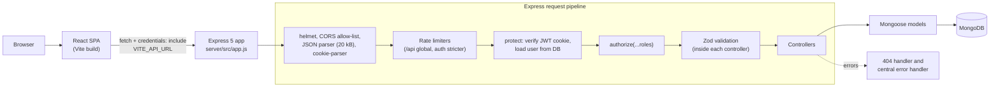
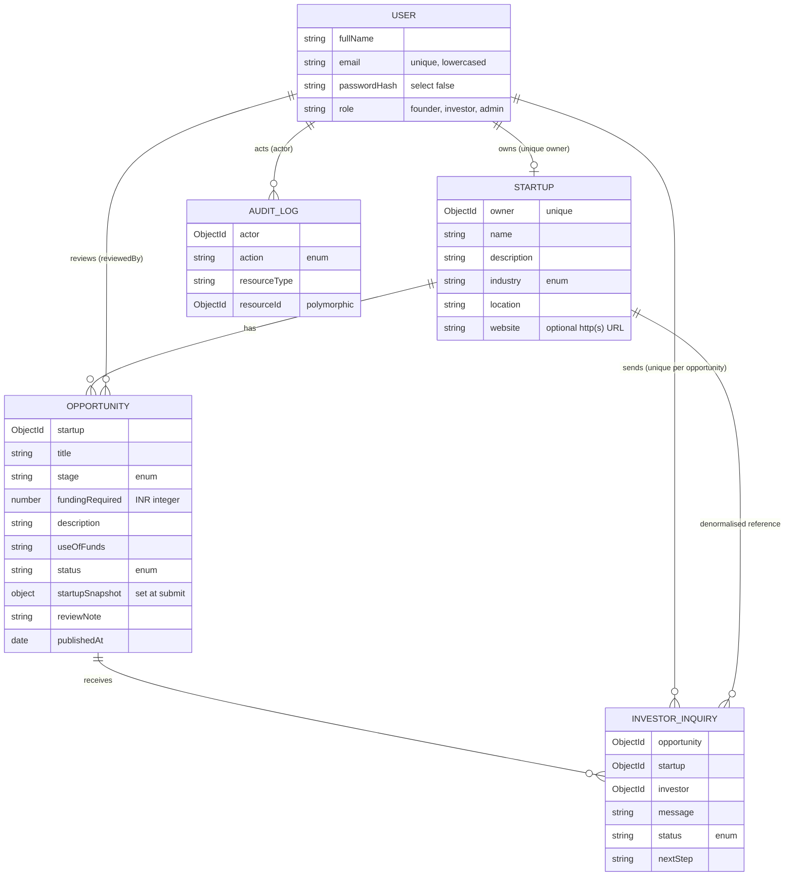
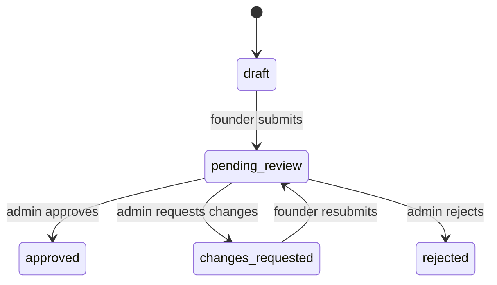
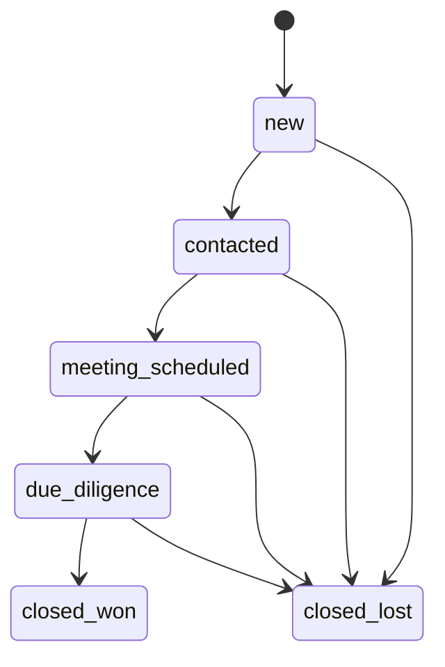
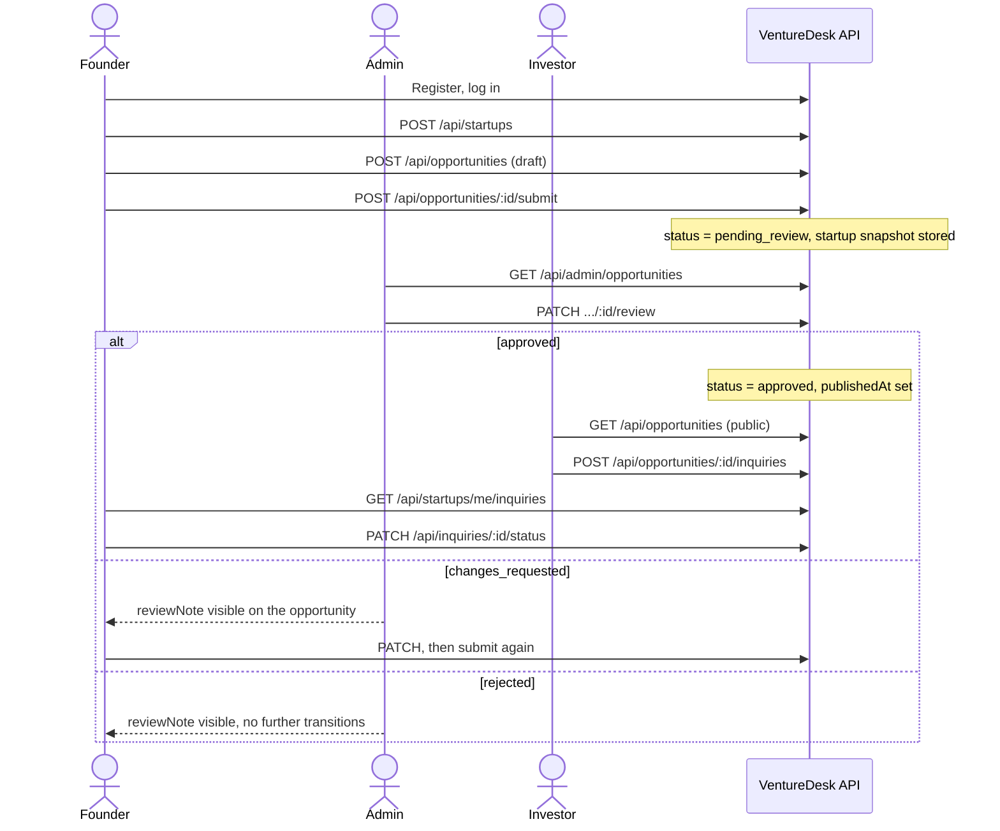

<div align="center">

# VentureDesk

**A role-based workflow for taking a startup from draft, to reviewed, to investor-ready.**


</div>

VentureDesk is a MERN-stack application that connects three groups around one controlled workflow. **Founders** describe their startup and package a funding request as an *opportunity*. **Admins** review each submitted opportunity and approve it, reject it, or send it back with feedback. **Investors** browse only the approved opportunities and open an inquiry, which the founder then moves through a simple deal pipeline.

> **Status:** local development only. No deployed URL has been verified (see [Build and Deployment](#build-and-deployment)). The project has no license file yet (see [License](#license)).

---

## Table of Contents

1. [Overview](#overview)
2. [Key Features](#key-features)
3. [User Roles and Permissions](#user-roles-and-permissions)
4. [Screenshots and Demo](#screenshots-and-demo)
5. [Technology Stack](#technology-stack)
6. [Architecture and Request Flow](#architecture-and-request-flow)
7. [Project Structure](#project-structure)
8. [Prerequisites](#prerequisites)
9. [Installation and Local Setup](#installation-and-local-setup)
10. [Environment Variables](#environment-variables)
11. [API Documentation](#api-documentation)
12. [Database Models and Relationships](#database-models-and-relationships)
13. [Authentication and Security](#authentication-and-security)
14. [Application Workflows](#application-workflows)
15. [Testing and Quality Assurance](#testing-and-quality-assurance)
16. [Build and Deployment](#build-and-deployment)
17. [Troubleshooting](#troubleshooting)
18. [AI-Assisted Development Experience](#ai-assisted-development-experience)
19. [Engineering Decisions](#engineering-decisions)
20. [Known Limitations and Future Improvements](#known-limitations-and-future-improvements)
21. [Contributing](#contributing)
22. [License](#license)
23. [Contact and Links](#contact-and-links)

---

## Overview

Early-stage fundraising has two recurring problems: investors see listings of uneven quality, and founders get little structured feedback. VentureDesk addresses both by putting a review step between a founder's draft and the investor-facing catalogue.

| Role | What they do in VentureDesk |
| --- | --- |
| **Founder** | Creates one startup profile, drafts one or more funding opportunities, submits them for review, revises them if changes are requested, and manages incoming investor inquiries. |
| **Admin** | Works a review queue of submitted opportunities and records a decision, with a mandatory note when requesting changes or rejecting. |
| **Investor** | Searches and filters approved opportunities (no account needed to browse), sends one inquiry per opportunity, and tracks or withdraws their own inquiries. |

Two design choices shape the data model. First, when a founder submits an opportunity the server stores a **snapshot** of the startup's details with it, so investors see exactly what the admin reviewed, even if the founder later edits their profile. Second, ownership and identity are always derived on the server from the authenticated session and the database, never from fields the client sends.

---

## Key Features

Everything below was confirmed in source code. Items marked **Partial** or **Not implemented** are called out explicitly.

### Authentication and account management
- Registration for the `founder` and `investor` roles; login; logout; session restore (`GET /api/auth/me`).
- JWT stored in an `HttpOnly` cookie; passwords hashed with bcrypt (cost 12).
- Role-based route guards in the SPA, and role checks on every protected API route.
- Profile page showing account details with a logout action. **Partial:** read-only, with no profile editing, password change, or password reset.
- Admin accounts cannot be self-registered. **Not implemented:** an admin-creation endpoint. Admins are created with the demo seed script or directly in the database.

### Founder workspace
- Dashboard with opportunity and inquiry counts derived from live API data.
- One startup profile per founder (create, view, edit) with a fixed industry list.
- Opportunity drafts (create, edit, list) with a completeness check before submission.

### Administrative review
- Review queue (default filter: `pending_review`) with a detail view.
- Three decisions: **approve**, **request changes**, **reject**. A review note is required for the last two.
- Atomic status transitions guarded against concurrent review.
- Append-only audit records for submissions, reviews, and inquiry events (stored only; not exposed through any endpoint).

### Opportunity discovery
- Public, unauthenticated catalogue of approved opportunities with search, industry, stage, location, and funding-range filters, sorting, and pagination.
- Public responses are built from the reviewed snapshot only. They never include owner IDs, review notes, or reviewer fields.
- Funding amounts are whole numbers in INR and are displayed in lakh/crore notation.

### Investor inquiries
- Investors send a message (max 1000 characters) on an approved opportunity. A unique index prevents duplicates.
- Founders see inquiries for their own startup (investor display name only, never email) and move them through the pipeline `new → contacted → meeting_scheduled → due_diligence → closed_won | closed_lost`.
- Investors can only withdraw their own inquiry (`closed_lost`).
- **Partial:** the API accepts an optional `nextStep` note and the founder view displays it, but no input for it was found in the UI.

### User interface
- React single-page app with CSS Modules and a shared design-token stylesheet, a role-aware sidebar shell, toast notifications, skeleton loaders, empty and error states with retry.
- `client/design.md` documents the visual system.

### Security and validation
- Zod schemas on every request body and query string, using strict mode so unknown fields are rejected.
- `helmet`, an exact-match CORS allow-list, a 20 kB JSON body limit, and rate limiting (see [Authentication and Security](#authentication-and-security)).

---

## User Roles and Permissions

Verified against the Express route registrations and controllers, not just the frontend navigation.

| Role | Main responsibilities | Permitted actions | Restricted actions |
| --- | --- | --- | --- |
| **Anonymous visitor** | Browse the catalogue | List approved opportunities (`GET /api/opportunities`); register; log in; check API health | Every other API route requires a session and returns `401` without one |
| **Founder** | Maintain startup and funding requests | Create, read, and update **own** startup; create, list, edit, and submit **own** opportunities (only in `draft` or `changes_requested`); list inquiries for own startup; advance or close inquiries on own startup | Cannot review opportunities, create inquiries, or touch another founder's data (foreign IDs return `404`) |
| **Investor** | Discover and engage | Create one inquiry per approved opportunity; list own inquiries; withdraw own inquiry (`closed_lost` only) | Cannot create startups or opportunities, cannot move an inquiry to any other status (`403`), cannot see founder email addresses |
| **Admin** | Quality control | List opportunities by status; read non-draft opportunity detail; approve, request changes on, or reject opportunities in `pending_review` | Cannot be self-registered; cannot change inquiry status (`403`); cannot read draft detail (`404`) |

---

## Screenshots and Demo

No screenshots are committed to the repository yet. Add real captures from a running instance at the paths below, then replace this table with image embeds.

| Screen | Route | Suggested path | Status |
| --- | --- | --- | --- |
| Landing page | `/` | `docs/screenshots/landing.png` | Not captured |
| Discovery with filters | `/startups` | `docs/screenshots/discovery.png` | Not captured |
| Opportunity detail and inquiry form | `/startups/:id` | `docs/screenshots/opportunity-detail.png` | Not captured |
| Founder dashboard | `/founder/dashboard` | `docs/screenshots/founder-dashboard.png` | Not captured |
| Opportunity editor | `/founder/opportunities/:id/edit` | `docs/screenshots/opportunity-editor.png` | Not captured |
| Founder inquiry pipeline | `/founder/inquiries` | `docs/screenshots/founder-inquiries.png` | Not captured |
| Investor dashboard | `/investor/dashboard` | `docs/screenshots/investor-dashboard.png` | Not captured |
| Admin review queue and detail | `/admin/reviews`, `/admin/reviews/:id` | `docs/screenshots/admin-review.png` | Not captured |

- **Live demo:** ` add URL once a deployment is verified`
- **Repository:** `[epository URL](https://github.com/Sukumar5705/VentureDesk)`

---

## Technology Stack

Only technologies present in `package.json` files and used in source are listed. Versions are the declared ranges.

### Frontend (`client/`)

| Technology | Role in this app |
| --- | --- |
| React `^19` + TypeScript `~6` | UI and typed API contracts (`src/api/*.ts`) |
| Vite `^8` with `@vitejs/plugin-react` | Dev server and production bundler |
| React Router `^7` | Client-side routing and role-based route guards |
| CSS Modules + CSS custom properties (`tokens.css`) | Component styling and design tokens. Tailwind is **not** used. |
| `lucide-react` | Icons |
| Oxlint | Linting |

### Backend (`server/`)

| Technology | Role in this app |
| --- | --- |
| Node.js (CommonJS) + Express `^5` | REST API |
| Mongoose `^9` | Schemas, validation, and queries against MongoDB |
| Zod `^4` | Request body and query validation |
| `dotenv` | Loads `server/.env` |
| `nodemon` (dev) | Auto-restart in development |

### Database
- **MongoDB**, reached through the `MONGODB_URI` connection string (Atlas or a local instance).

### Authentication and security
- `jsonwebtoken` (HS256), `bcryptjs`, `cookie-parser`, `helmet`, `cors`, `express-rate-limit`.

### Validation and testing
- Zod schemas on the server. Five offline Node smoke-test scripts in `server/src/scripts/` (no test framework). See [Testing](#testing-and-quality-assurance).

### Development tools
- Kiro was the primary AI-assisted coding tool (see [AI-Assisted Development Experience](#ai-assisted-development-experience)). No CI, Docker, or deployment configuration is present in the repository.

---

## Architecture and Request Flow



**Where things happen**

| Concern | Location |
| --- | --- |
| Security headers, CORS, body parsing, rate limiting, route mounting, 404 and error handlers | `server/src/app.js` |
| DB connection and startup | `server/src/config/db.js`, `server/src/server.js` (API only starts listening after MongoDB connects) |
| Authentication (`protect`) and role checks (`authorize`) | `server/src/middleware/authMiddleware.js`, applied per router |
| Request validation | Zod schemas in `server/src/validators/`, called from controllers (`safeParse`) |
| Ownership enforcement | Controllers: the founder's startup is looked up by `req.user.id`, and queries are scoped to it |
| Persistence and constraints | `server/src/models/` (enums, lengths, unique indexes) |
| Error format | Always `{ "error": { "code", "message", "details?" } }` |

**Frontend flow.** `AuthProvider` calls `GET /api/auth/me` on load to restore the session. `RouteGuard` redirects unauthenticated visitors to `/login` and sends a user who opens a route for another role to their own dashboard. All requests go through `src/api/client.ts`, which always sends cookies and turns error responses into a typed `ApiRequestError`. A `401` on any call clears the in-memory session.

---

## Project Structure

```text
VentureDesk/
├── .gitignore
├── .kiro/
│   └── specs/venturedesk-frontend/
│       ├── .config.kiro              # Kiro spec metadata (requirements-first workflow)
│       └── requirements.md           # Frontend requirements spec
├── client/                           # React + TypeScript + Vite SPA
│   ├── design.md                     # UI design specification
│   ├── index.html
│   ├── package.json
│   ├── vite.config.ts
│   ├── tsconfig*.json, .oxlintrc.json
│   ├── public/                       # favicon.svg, icons.svg
│   └── src/
│       ├── main.tsx                  # Entry point
│       ├── App.tsx                   # Route table and guards
│       ├── tokens.css, index.css, App.css
│       ├── api/                      # client.ts (fetch wrapper) + auth, startups,
│       │                             #   opportunities, inquiries, admin
│       ├── contexts/                 # AuthContext, ToastContext
│       ├── components/
│       │   ├── layout/               # AppShell, Sidebar, PublicNavbar
│       │   └── ui/                   # Button, Input, RouteGuard, Toast, StatusBadge,
│       │                             #   MetricCard, Skeleton, EmptyState, ErrorState, Logo
│       ├── pages/
│       │   ├── public/               # Landing, Discovery, OpportunityDetail
│       │   ├── auth/                 # Login, Register
│       │   ├── founder/              # Dashboard, Startup, Opportunities, Inquiries
│       │   ├── investor/             # InvestorDashboard
│       │   ├── admin/                # AdminDashboard, AdminReviews, AdminReviewDetail
│       │   ├── ProfilePage.tsx
│       │   └── NotFoundPage.tsx
│       └── utils/format.ts           # INR, date, and status formatting helpers
└── server/                           # Express + Mongoose API
    ├── .env.example
    ├── package.json
    └── src/
        ├── server.js                 # Loads env, connects DB, starts listener
        ├── app.js                    # Middleware stack, routes, error handling
        ├── config/db.js              # Mongoose connection
        ├── controllers/              # auth, startup, opportunity, inquiry
        ├── middleware/authMiddleware.js
        ├── models/                   # User, Startup, Opportunity, InvestorInquiry, AuditLog
        ├── routes/                   # auth, startup, opportunity, adminOpportunity, inquiry
        ├── validators/               # Zod schemas
        └── scripts/                  # smokeTest*.js (5) and sampledatafeed.js (demo seed)
```

There is no root-level `package.json`. `client/` and `server/` are installed and run independently.

---

## Prerequisites

| Requirement | Detail |
| --- | --- |
| **Node.js** | `^20.19.0` or `>=22.12.0`. No `engines` field is declared in the project; this is the intersection of the installed Vite 8 and Mongoose 9 requirements (`>=20.19.0`). Verified in this review on Node 22.22.0. |
| **npm** | Lockfiles are `package-lock.json` (npm). Verified with npm 10.9.4. |
| **MongoDB** | A MongoDB Atlas cluster or a local MongoDB server, reachable through a connection string. |
| **Git** | To clone the repository. |

---

## Installation and Local Setup

The API and the web app are separate processes. Use **two terminals**.

**1. Clone**

```bash
git clone <REPOSITORY_URL> VentureDesk
cd VentureDesk
```

**2. Backend: install and configure (terminal 1)**

```bash
cd server
npm install
cp .env.example .env        # Windows PowerShell: Copy-Item .env.example .env
```

Edit `server/.env`:

- Set `MONGODB_URI` to your Atlas or local connection string. The example file contains a placeholder that must be replaced.
- Set `JWT_SECRET` to a long random value. The server warns if it is shorter than 32 characters. One way to generate one:

  ```bash
  node -e "console.log(require('crypto').randomBytes(48).toString('hex'))"
  ```

- Leave `CLIENT_ORIGIN=http://localhost:5173` (Vite's default dev port) unless you change the frontend port.

**3. Backend: start**

```bash
npm run dev      # nodemon, restarts on change
# or
npm start        # plain node
```

Expected output includes `MongoDB connected successfully: <db name>` and `VentureDesk API running at http://localhost:5000`. Confirm with:

```bash
curl http://localhost:5000/api/health
```

**4. Frontend: install and start (terminal 2)**

```bash
cd client
npm install
npm run dev
```

The frontend defaults to calling `http://localhost:5000`. If your API runs elsewhere, create `client/.env` first (no example file exists in the repo):

```bash
echo "VITE_API_URL=http://localhost:5000" > .env
```

**5. Open the app** at <http://localhost:5173> (the URL Vite prints).

**6. (Optional) Load demo data**

```bash
cd server
node src/scripts/sampledatafeed.js
```

This script connects to the database named in `MONGODB_URI` and idempotently upserts demo users, startups, opportunities, inquiries, and tagged audit records. It also **resets the demo users' passwords** to the `DEMO_PASSWORD` constant defined at the top of the script and prints the demo login emails (including `admin@venturedesk.demo`). Run it only against a development database, and remove the script before any real deployment. Its own output recommends deleting it after use. There is no `npm` script for it.

---

## Environment Variables

### Server: `server/.env` (template: `server/.env.example`)

| Variable | Purpose | Required | Default / example |
| --- | --- | --- | --- |
| `MONGODB_URI` | MongoDB connection string. Startup fails with `MONGODB_URI is missing from server/.env` if absent. | **Yes** | `mongodb+srv://<user>:<password>@<cluster>/<db>` (placeholder) |
| `JWT_SECRET` | HS256 signing secret. If missing, login and all protected routes return `500`. A warning is logged when shorter than 32 characters. | **Yes** | Long random string (never commit) |
| `CLIENT_ORIGIN` | The single allowed browser origin for CORS (exact string match). If unset, only requests with no `Origin` header (curl, server-to-server) are accepted. | **Yes** for browser use | `http://localhost:5173` |
| `JWT_EXPIRES_IN` | Token and cookie lifetime. Format `<number><s\|m\|h\|d>`; anything else falls back to 2 hours. | Optional | `2h` |
| `PORT` | API listen port. | Optional | `5000` |
| `NODE_ENV` | When `production`, the auth cookie is set with `Secure`. | Optional | `development` in the example file |

### Client: `client/.env` (no example file exists)

| Variable | Purpose | Required | Default |
| --- | --- | --- | --- |
| `VITE_API_URL` | Base URL of the API, read in `src/api/client.ts`. Baked into the bundle at build time. | Optional | `http://localhost:5000` |

`.gitignore` excludes `.env` files and keeps `.env.example` files tracked. Never commit real credentials.

---

## API Documentation

**Base path:** `/api`. **Auth:** an `HttpOnly` cookie named `venturedesk_token`, set by login. **Format:** JSON.

**Response envelopes**

| Case | Shape |
| --- | --- |
| Success | `{ "data": ... }` |
| Paginated | `{ "data": [...], "pagination": { "page", "limit", "total", "pages" } }` |
| Error | `{ "error": { "code", "message", "details": [{ "field", "message" }] } }` (`details` appears on validation errors) |

Error codes seen in the code: `VALIDATION_ERROR`, `BAD_REQUEST`, `UNAUTHORIZED`, `FORBIDDEN`, `NOT_FOUND`, `CONFLICT`, `RATE_LIMITED`, `PAYLOAD_TOO_LARGE`, `SERVER_ERROR`.

Request bodies are validated with `.strict()`, so **any unknown field returns `400`**. IDs in paths must be valid ObjectIds or the API returns `400`.

### Health

| Method | Path | Auth | Purpose |
| --- | --- | --- | --- |
| GET | `/api/health` | None | `200` with `database: "connected"` or `503` with `"disconnected"`. Registered before the rate limiter. |

### Authentication

| Method | Path | Auth | Body | Behavior |
| --- | --- | --- | --- | --- |
| POST | `/api/auth/register` | None (20 req / 15 min / IP) | `fullName` (1–100), `email`, `password` (8+ chars, ≤72 bytes), `role` (`founder` \| `investor`) | `201` with the public user. `409` if the email exists. Does **not** set a cookie. |
| POST | `/api/auth/login` | None (20 failed req / 15 min / IP) | `email`, `password` | `200` with the public user and sets the cookie. `401` with a generic message for bad credentials. |
| POST | `/api/auth/logout` | None | none | Always `200`. Clears the cookie. |
| GET | `/api/auth/me` | Any logged-in user | none | `200` with the current user, or `401`. |

```bash
# Register, log in, and call a protected route with a cookie jar
curl -X POST http://localhost:5000/api/auth/register \
  -H "Content-Type: application/json" \
  -d '{"fullName":"Asha Founder","email":"asha@example.com","password":"<password>","role":"founder"}'

curl -c cookies.txt -X POST http://localhost:5000/api/auth/login \
  -H "Content-Type: application/json" \
  -d '{"email":"asha@example.com","password":"<password>"}'

curl -b cookies.txt http://localhost:5000/api/auth/me
```

### Startup management (founder only)

| Method | Path | Body | Behavior |
| --- | --- | --- | --- |
| POST | `/api/startups` | `name` (≤100), `description` (≤2000), `industry` (enum), `location` (≤100), optional `website` (http/https URL, ≤300) | `201`. `409` if the founder already has a profile. Owner comes from the session. |
| GET | `/api/startups/me` | none | Own profile, or `404` if none. |
| PATCH | `/api/startups/me` | Any subset of the create fields; `website` may be `null`; at least one field | Updates own profile only. |
| GET | `/api/startups/me/inquiries` | Query: `page`, `limit` (1–50, default 20), `status` | Inquiries on the founder's startup, newest first. Shows the investor's `fullName`, never their email. |

`industry` values: `ai_ml`, `agritech`, `climate_energy`, `cybersecurity`, `ecommerce`, `edtech`, `fintech`, `healthtech`, `logistics`, `real_estate`, `saas`, `consumer`, `other`.

### Opportunities

| Method | Path | Auth / role | Purpose |
| --- | --- | --- | --- |
| GET | `/api/opportunities` | **None** | Public discovery list. Status is hard-coded to `approved`. |
| POST | `/api/opportunities` | Founder | Create a draft. Only `title` is required. Requires an existing startup profile (`404` otherwise). |
| GET | `/api/opportunities/mine` | Founder | List own opportunities (empty list if no startup yet). |
| PATCH | `/api/opportunities/:id` | Founder | Edit own opportunity. `409` unless status is `draft` or `changes_requested`. |
| POST | `/api/opportunities/:id/submit` | Founder | Moves to `pending_review` and stores the startup snapshot. `400` if `stage`, `fundingRequired`, `description`, or `useOfFunds` is missing. `409` on wrong status or concurrent change. |
| POST | `/api/opportunities/:id/inquiries` | Investor | Create an inquiry (see below). |

**Opportunity body fields** (create/update): `title` (≤150), `stage` (`pre_seed`, `seed`, `series_a`, `series_b`, `series_c_plus`, `other`), `fundingRequired` (positive integer, INR), `description` (≤2000), `useOfFunds` (≤2000). Update requires at least one field.

**Public list query parameters** (unknown parameters return `400`):

| Parameter | Rule |
| --- | --- |
| `page` | Integer ≥ 1 (default 1) |
| `limit` | 1–100 (default 20) |
| `search` | Up to 100 chars. Case-insensitive match on title, description, startup name. |
| `industry` | String, matched exactly against the snapshot industry |
| `stage` | Stage enum |
| `location` | Up to 100 chars, case-insensitive partial match |
| `minFunding`, `maxFunding` | Integers ≥ 0, with `minFunding ≤ maxFunding` |
| `sortBy` | `publishedAt` (default), `fundingRequired`, `createdAt` |
| `order` | `desc` (default) or `asc` |

Each item contains `id`, `title`, `stage`, `fundingRequired`, `description`, `useOfFunds`, `publishedAt`, and a `startup` object (`name`, `description`, `industry`, `location`, `website`) taken from the reviewed snapshot.

### Administrative review (admin only)

All routes under `/api/admin/opportunities` require `protect` and `authorize("admin")`.

| Method | Path | Behavior |
| --- | --- | --- |
| GET | `/api/admin/opportunities` | Query: `status` (default `pending_review`), `page`, `limit` (1–100). Sorted by `submittedAt` then `createdAt`, newest first. **See the known issue about the `page` default.** |
| GET | `/api/admin/opportunities/:id` | Full record including reviewer fields. Drafts return `404`. |
| PATCH | `/api/admin/opportunities/:id/review` | Body: `decision` (`approved` \| `changes_requested` \| `rejected`), `reviewNote` (≤1000; **required** for the last two). Only valid from `pending_review` (`409` otherwise). Approval sets `publishedAt`. |

```bash
curl -b admin-cookies.txt -X PATCH http://localhost:5000/api/admin/opportunities/<id>/review \
  -H "Content-Type: application/json" \
  -d '{"decision":"changes_requested","reviewNote":"Please clarify the use of funds."}'
```

### Investor inquiries

| Method | Path | Auth / role | Behavior |
| --- | --- | --- | --- |
| POST | `/api/opportunities/:id/inquiries` | Investor | Body: `message` (1–1000). The opportunity must be `approved` (else `404`). `409` if this investor already inquired. |
| GET | `/api/inquiries/mine` | Investor | Query: `page`, `limit` (1–50, default 20), `status`. Includes a summary built from the opportunity snapshot. |
| PATCH | `/api/inquiries/:id/status` | Investor or Founder | Body: `status`, optional `nextStep` (1–500). Ownership comes from the database; a non-owner gets `404`. Investors may only set `closed_lost` with no `nextStep` (else `403`). Invalid transitions return `409`. Admins get `403`. |

Allowed inquiry transitions are listed under [Database Models](#database-models-and-relationships).

---

## Database Models and Relationships



All five models use Mongoose `timestamps` (`AuditLog` has `createdAt` only).

| Model (collection) | Purpose | Key constraints |
| --- | --- | --- |
| `User` (`users`) | Accounts | `email` unique index, lowercased and trimmed; `passwordHash` has `select: false`; `role` enum `founder` / `investor` / `admin` |
| `Startup` (`startups`) | A founder's company profile | Unique index on `owner` (one startup per founder); `industry` enum; `website` must be http(s) |
| `Opportunity` (`opportunities`) | A funding request | `status` enum: `draft`, `pending_review`, `changes_requested`, `approved`, `rejected`. `fundingRequired` integer between 1 and 100,000,000,000. `reviewNote` required (pre-validate hook) for `changes_requested` / `rejected`. Indexes on `{status, publishedAt}` and `{status, submittedAt}`. |
| `InvestorInquiry` (`investor_inquiries`) | Investor interest in an opportunity | Unique compound index `{investor, opportunity}`; index `{startup, createdAt}`; `message` ≤1000; `nextStep` ≤500 |
| `AuditLog` (`audit_logs`) | Append-only history of status changes | `action` enum; `resourceId` references different collections depending on `resourceType` |

**Opportunity lifecycle**



`approved` and `rejected` have no outgoing transitions in the code.

**Inquiry lifecycle** (`InvestorInquiry.ALLOWED_TRANSITIONS`)



`closed_won` and `closed_lost` are terminal.

---

## Authentication and Security

| Area | Implementation |
| --- | --- |
| **Registration** | Zod-validated; role limited to `founder` / `investor`; email lowercased; unique index is the final duplicate guard (`409`). |
| **Password hashing** | `bcryptjs`, cost 12. Passwords are limited to 72 **bytes** because bcrypt ignores the rest. |
| **Login** | `bcrypt.compare` always runs, against a dummy hash when the email is unknown, to keep response time similar. The error message is identical for unknown email and wrong password. |
| **JWT** | HS256, payload `{ sub: userId }` only (no role in the token). Verified with an explicit `algorithms: ["HS256"]`. Lifetime from `JWT_EXPIRES_IN`; the cookie `maxAge` is derived from the same value. |
| **Token storage and transport** | `HttpOnly` cookie `venturedesk_token`, `SameSite=Lax`, `Path=/`, `Secure` when `NODE_ENV=production`. The token is never returned in a response body, and the frontend never reads it. |
| **Protected routes** | `protect` verifies the cookie and **reloads the user from MongoDB on every request**, so role changes and deleted users take effect immediately. |
| **Role-based access** | `authorize(...roles)` after `protect`: `401` without a user, `403` for the wrong role. |
| **Ownership** | Founders: the startup is found via `owner = req.user.id` and opportunity queries are scoped to it. Inquiry updates filter by ownership in the database query, and non-owners get `404` to avoid revealing which IDs exist. Client-supplied owner, startup, or investor fields are rejected by strict schemas. |
| **Concurrency** | Status changes use `findOneAndUpdate` with the expected current status in the filter, returning `409` if it changed. |
| **Data exposure** | Responses are built with explicit field mapping. Public data comes from the snapshot. Founders see investor names but never emails. |
| **Validation** | Zod on bodies and queries. Mongoose validators act as a second layer. User text in search and location filters is regex-escaped. |
| **Rate limiting** | 300 requests / 15 min / IP on `/api`; register and login each limited to 20 / 15 min / IP (login counts failed attempts only). In-memory store. |
| **Other middleware** | `helmet`, `x-powered-by` disabled, `trust proxy` set to 1, 20 kB JSON body limit, exact-match CORS with `credentials: true`. |
| **Error handling** | Central handler returns a consistent shape. Malformed JSON gives `400`; oversized body gives `413`; unexpected errors give a generic `500` without internals. |

Weaknesses and gaps are listed under [Known Limitations](#known-limitations-and-future-improvements) rather than glossed over.

---

## Application Workflows



1. **Founder onboarding.** Register as `founder`, log in, and create the single startup profile. Opportunities cannot be created until the profile exists.
2. **Drafting.** Create an opportunity with just a title, then fill in stage, amount, description, and use of funds at any time while it is `draft` or `changes_requested`.
3. **Submission.** Submitting checks completeness, captures the startup snapshot, and records an audit entry.
4. **Review.** An admin opens the queue and approves, requests changes, or rejects. Feedback is stored as `reviewNote`. A founder resubmitting after `changes_requested` is logged as a resubmission.
5. **Discovery.** Approved opportunities appear in the public catalogue. Anyone can browse. Only logged-in investors can send an inquiry.
6. **Inquiry management.** The founder advances the inquiry along the pipeline or closes it as lost. The investor can withdraw. Every change is recorded in the audit log.

**Frontend routes**

| Area | Routes |
| --- | --- |
| Public | `/`, `/startups`, `/startups/:id`, `/login`, `/register` |
| Founder | `/founder/dashboard`, `/founder/startups`, `/founder/startups/new`, `/founder/opportunities`, `/founder/opportunities/new`, `/founder/opportunities/:id/edit`, `/founder/inquiries` |
| Investor | `/investor/dashboard` |
| Admin | `/admin/dashboard`, `/admin/reviews`, `/admin/reviews/:id` |
| Any logged-in user | `/profile` |

---

## Testing and Quality Assurance

### What exists

There is **no test framework**, no frontend test suite, and `npm test` in `server/` is the unmodified placeholder (`echo "Error: no test specified" && exit 1`). The automated checks are five offline smoke-test scripts. They run without MongoDB: they stub the Mongoose models in memory and exercise the real Express app over HTTP.

| Command (from `server/`) | What it verifies |
| --- | --- |
| `node src/scripts/smokeTestModels.js` | Schema structure, enums, required fields, and the inquiry transition table (no DB connection) |
| `node src/scripts/smokeTestAuth.js` | Register, login, logout, `/me`, cookie flags, password and email validation, missing-secret handling, malformed JSON |
| `node src/scripts/smokeTestStartup.js` | Startup create, read, and update, one-per-founder rule, owner-field rejection, role enforcement |
| `node src/scripts/smokeTestOpportunity.js` | Opportunity create, edit, submit, admin list and review, status guards, concurrent-change conflicts, audit records |
| `node src/scripts/smokeTestInquiry.js` | Public discovery filters and validation, inquiry creation and duplicates, ownership, transitions, response shapes |

Because the data layer is stubbed, these scripts **cannot** prove the real unique indexes or MongoDB's atomic updates. The inquiry script says so itself.

### Frontend checks (from `client/`)

```bash
npm run lint     # oxlint
npm run build    # tsc -b && vite build  → output in client/dist
```

### Results of the last recorded run

Run on **2026-10-10**, Node 22.22.0, npm 10.9.4, fresh `npm ci`. Re-run before relying on these numbers.

| Check | Result |
| --- | --- |
| `smokeTestModels.js` | 44 passed, 0 failed |
| `smokeTestAuth.js` | 44 passed, 0 failed |
| `smokeTestStartup.js` | 40 passed, 0 failed |
| `smokeTestOpportunity.js` | **83 passed, 1 failed.** The failing assertion expects `GET /api/admin/opportunities?status=draft` to return `400`, but the validator accepts `draft`. |
| `smokeTestInquiry.js` | **Does not run as committed.** It requires `../../../phase5-changes/src/app`, which does not exist. With that path pointed at `../app` in a temporary copy, it ran with **103 passed, 4 failed** (it expects a default page size of 12, a maximum `limit` of 50, rejection of `maxFunding=0`, and an enum-validated `industry`; the current validators use 20, 100, allow 0, and accept any string). |
| `npm run lint` | Exit code 0 with 12 warnings (`set-state-in-effect`, `only-export-components`), no errors |
| `npm run build` | Succeeds |

The two failing scripts reflect test drift from the current validators rather than a known runtime fault. They are tracked under [Known Limitations](#known-limitations-and-future-improvements).

### Not covered
No frontend unit or component tests, no browser end-to-end tests, no tests against a real MongoDB instance, no CI pipeline, and no coverage measurement.

---

## Build and Deployment

No deployment provider has been chosen or verified. The notes below describe what the code requires.

**Frontend**

```bash
cd client
VITE_API_URL=https://<your-api-host> npm run build   # output: client/dist
```

- `VITE_API_URL` is read at build time. It is not a runtime setting.
- The app uses `BrowserRouter`, so the static host must serve `index.html` for all unknown paths. No host-specific rewrite file (such as `vercel.json` or `_redirects`) exists in the repository.
- `client/index.html` references `/logo.png` as its favicon, but that file is not in `client/public/`.

**Backend**

```bash
cd server
npm ci
NODE_ENV=production npm start
```

Set `MONGODB_URI`, `JWT_SECRET`, and `CLIENT_ORIGIN` (the exact deployed frontend origin, with no trailing slash) in the host's environment. `PORT` is read from the environment. `GET /api/health` returns `200` or `503` and can serve as a health check.

**Deployment constraints to plan for**

- **Cookies and domains.** The auth cookie is `SameSite=Lax`. Browsers do not send it on cross-site `fetch` requests, so the frontend and API should share a registrable domain (for example `app.example.com` and `api.example.com`) or sit behind one reverse proxy. Hosting them on unrelated domains will break login as currently implemented.
- **HTTPS.** With `NODE_ENV=production` the cookie is `Secure`, so the site must be served over HTTPS.
- **Reverse proxy.** The app sets `trust proxy` to `1`, which assumes one proxy hop in front of it.
- **Rate limiting** uses an in-memory store, so limits are per process rather than shared across instances.
- **MongoDB access.** If using Atlas, allow the server's outbound IP in the cluster's network access list. The driver gives up after 10 seconds.
- Provider-specific steps: `TODO: pending, to be added once a platform is chosen and tested`.

---

## Troubleshooting

| Symptom | Likely cause and fix |
| --- | --- |
| `Unable to start VentureDesk API: MONGODB_URI is missing from server/.env` | `server/.env` is missing or lacks `MONGODB_URI`. Run `cp .env.example .env` inside `server/` and fill it in. |
| `MongoDB connection failed` after about 10 seconds | Wrong URI or credentials, Atlas IP not allow-listed, or a local `mongod` that is not running. Check the URI, the Atlas network access list, and the service status. |
| `EADDRINUSE` on port 5000 | Another process uses the port. Change `PORT` in `server/.env` and set `VITE_API_URL` to match. On macOS/Linux: `lsof -i :5000`. |
| Browser shows a CORS error or `403 Origin not allowed by CORS` | `CLIENT_ORIGIN` does not exactly match the page origin (scheme, host, port, no trailing slash). If Vite picked a different port, update it and restart the API. |
| Login returns `500` / server logs `[auth] JWT_SECRET is not set` | Set `JWT_SECRET` in `server/.env` and restart. |
| `401 Authentication required` or `Invalid or expired token` | The cookie is missing, expired (default 2 h), or the secret changed. Log in again. Requests from the frontend need `credentials: 'include'`, which `src/api/client.ts` already sets. |
| Login works in dev but the session disappears in production | Cookie domain or `Secure` mismatch. See [deployment constraints](#build-and-deployment). |
| `429 RATE_LIMITED` | More than 20 register or failed login attempts in 15 minutes from one IP. Wait, or restart the server in development (the limiter is in memory). |
| `400 VALIDATION_ERROR` | Read `error.details[]`. Each entry has `field` and `message`. Unknown fields are rejected by design. |
| Frontend shows "Network error, please check your connection" | The API is not running or `VITE_API_URL` is wrong. Check `curl http://localhost:5000/api/health`. |
| Admin routes unavailable | Admins cannot register through the app. Seed the demo data (see [setup step 6](#installation-and-local-setup)) or create an admin user directly in the database. |
| `npm run build` fails with TypeScript errors, or `npm install` warns about engines | Check `node --version` against [Prerequisites](#prerequisites). Delete `node_modules` and reinstall with `npm ci`. |

---

## AI-Assisted Development Experience

I built VentureDesk with **Kiro as my primary AI-assisted coding tool**, and used **ChatGPT and other AI tools for selected planning, debugging, review, and design-refinement tasks**. The code was produced with substantial AI assistance. My own contribution was directing the work, reviewing the output, running it, and correcting it. I am not presenting the generated code as independently hand-written.

What the repository itself shows:

1. **Spec-driven frontend with Kiro.** `.kiro/specs/venturedesk-frontend/` holds a requirements-first Kiro spec (`.config.kiro` records the `requirements-first` workflow). It defines user stories and acceptance criteria for the app shell, authentication, discovery, and role dashboards.
2. **A portable design brief.** `client/design.md` is a long UI specification written so that any AI coding assistant could implement the same visual system. It maps reference-dashboard layout ideas onto real VentureDesk screens and states that no fake metrics should be used. The dashboards read live API data.
3. **Backend built in reviewable phases.** The five smoke-test scripts are labelled by phase (models, auth, startup profile, opportunity workflow, investor discovery and inquiries). Each script exercises one phase offline, which gives a repeatable way to check generated code.
4. **Review and correction.** The tests and the build were the check on AI output. Running them against the final code also exposed drift: two suites no longer match the validators (see [Testing](#testing-and-quality-assurance)). That is why they are reported here as they are, not as passing.

> **TODO (author):** if you want per-tool attribution (for example which tasks used ChatGPT instead of Kiro, or specific bugs an AI tool helped diagnose), add it here. The repository does not record it, so it is intentionally not claimed.

---

## Engineering Decisions

Each decision below is visible in the code and its comments. The reasoning column gives the standard rationale for the pattern.

| Decision | Problem | Reasoning |
| --- | --- | --- |
| **Snapshot the startup at submission** (`Opportunity.startupSnapshot`) | A founder could change the startup profile after an admin approved a listing, so investors would see unreviewed content. | The server copies the startup fields into the opportunity at submit time, and public and inquiry responses read only from that snapshot. |
| **Derive identity and ownership server-side** | Trusting client-sent `owner`, `startup`, or `investor` IDs allows impersonation. | Strict Zod schemas reject those fields, and controllers resolve them from `req.user` and the database. |
| **Guarded atomic transitions** | Two requests could move the same record at once (for example two admins reviewing). | `findOneAndUpdate` includes the expected current status in its filter, and a miss returns `409`. |
| **Cookie-based JWT with role read from the DB** | Tokens in `localStorage` are readable by scripts, and roles inside a token go stale. | `HttpOnly` cookie, with only the user ID in the token and the role reloaded on each request. |
| **Cookie and token lifetime computed once** | `jsonwebtoken` treats a numeric `expiresIn` as seconds, so mismatched units can leave the cookie and token out of step. | `getTokenLifetime()` derives both values from one parsed setting. |
| **Equalised login timing** | Skipping the hash comparison for unknown emails leaks which emails exist. | A dummy bcrypt hash is compared when no user is found. |
| **`404` for foreign inquiries** | A `403` would confirm that an ID exists. | Ownership is part of the query, so non-owners see "not found". |

---

## Known Limitations and Future Improvements

### Current limitations

Items 1–4 are defects found by reading the code. They have not been reproduced against a live database.

1. **Registration does not sign the user in, but the UI expects it to.** `AuthContext.register()` calls `GET /api/auth/me` immediately after `POST /api/auth/register`, but only `login` sets the cookie. The account is created, but the UI likely reports an error ("Authentication required") instead of redirecting. Logging in afterwards works.
2. **Wrong default `page` for the admin list.** In `adminListQuerySchema`, `page` defaults to the string `"20"` rather than `1`. A request without `page` therefore skips the first 19 pages. The bundled frontend always sends `page`, so the UI is unaffected, but direct API calls are.
3. **Broken sidebar link for investors.** The investor sidebar links to `/investor/inquiries`, which has no route and shows the 404 page. Inquiries are shown on `/investor/dashboard`.
4. **Opportunity detail depends on the list endpoint.** There is no `GET /api/opportunities/:id`. The detail page requests the 100 newest approved opportunities and searches them by ID, so an older listing may show "not found".
5. **Smoke tests have drifted from the code** (details under [Testing](#testing-and-quality-assurance)): `smokeTestInquiry.js` has a stale import path and 4 assertions that disagree with the validators, and `smokeTestOpportunity.js` has 1. The admin list also accepts `status=draft`, which returns draft rows even though the detail route hides them.
6. **No admin provisioning path.** Admins exist only via the seed script or manual database edits.
7. **No CSRF token.** Protection relies on `SameSite=Lax` and the CORS allow-list.
8. **No server-side session revocation.** Logout clears the cookie, but a captured token stays valid until it expires.
9. **No account recovery or verification.** No email verification, password reset, profile editing, or account deletion.
10. **No way to withdraw or archive an approved opportunity.** Approved and rejected opportunities cannot be edited or transitioned.
11. **Audit logging is partial.** `startup.created` and `startup.updated` actions are defined but never written. Audit writes are best-effort, so a failure is logged and the request still succeeds. Logs are not readable through the API.
12. **Fragile import.** `opportunityController.js` imports its validators via `../../../server/src/validators/opportunityValidators`, which only works while the folder is named `server`. It should be `../validators/opportunityValidators`.
13. **Minor repository hygiene.** The favicon path points to a missing file. The `router` package in `server/package.json` appears unused. There is no client `.env.example`, no CI, and no `LICENSE`. `requirements.md` still describes a JavaScript frontend, Inter font, and a 128-character password limit, which differ from the implementation (TypeScript, Plus Jakarta Sans, a 72-byte limit).
14. **Founder UI gap.** The API supports `nextStep` on inquiries, but the founder screen has no field to set it.

### Planned or optional improvements

- Fix items 1–3 and 12, add `GET /api/opportunities/:id`, and bring the smoke tests back in line (or convert them to a test runner such as Jest or Vitest with `mongodb-memory-server`).
- Add frontend component tests and a CI workflow that runs lint, build, and the server tests.
- Add an admin-creation or invite flow, email verification, and password reset.
- Add a CSRF defence and a way to revoke sessions.
- Expose audit history to admins; add withdraw/archive for published opportunities.
- Add a documented deployment target and a `client/.env.example`.

---

## Contributing

Contributions are welcome once a license is chosen. Until then, please open an issue before sending a pull request.

1. Fork and branch from `main`.
2. Install both packages (`client/` and `server/`) as described in [setup](#installation-and-local-setup).
3. Keep changes focused. Run `npm run lint` and `npm run build` in `client/`, and the relevant smoke tests in `server/`.
4. Do not commit `.env` files or credentials.
5. Describe the behavior change and how you verified it in the pull request.

---

## License

**No license has been specified.** The repository contains no `LICENSE` file. (`server/package.json` carries the npm default `"license": "ISC"`, but this is not a grant of rights on its own.) Until the author adds a license, all rights are reserved by default.

---

## Contact and Links

| | |
| --- | --- |
| **Author** | `Sukumar Erugadindla` |
| **Contact** | `https://sukumars-portfolio.vercel.app/` |
| **Repository** | `https://github.com/Sukumar5705/VentureDesk` |
| **Live demo** | ` (not yet verified)` |
